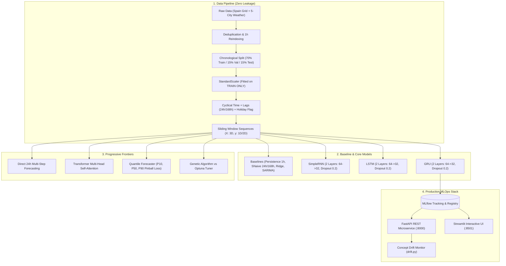

# ⚡ Energy Demand Forecaster: Comparative Study of RNN, LSTM, and GRU

[](https://www.python.org/)
[](https://www.tensorflow.org/)
[](https://fastapi.tiangolo.com/)
[](https://streamlit.io/)
[](https://mlflow.org/)
[](https://www.docker.com/)

A rigorous, end-to-end, portfolio-grade deep learning and MLOps system that forecasts hourly electricity demand using Spanish transmission grid data (2015–2018). The project features an honest, identical-condition comparison between **SimpleRNN**, **LSTM**, and **GRU** against naive and classical baselines, explores progressive forecasting frontiers (multivariate ablation, direct multi-step horizons, evolutionary genetic algorithm tuning, Transformers, and quantile prediction intervals), and packages the solution in a Dockerized production stack.

---

## 📚 Academic Syllabus & Topic Mapping

This project serves as an end-to-end coursework and capstone demonstration across foundational machine learning and deep sequential modeling:

| Course Syllabus Topic | Implementation in this Repository | File / Module Reference |
| :--- | :--- | :--- |
| **Gradient Descent & Backprop** | Mini-batch Adam and SGD with Backpropagation Through Time (BPTT) | [`src/models/rnn_models.py`](file:///C:/Users/Kanchan%20Kumari/.gemini/antigravity/scratch/energy-demand-forecaster/src/models/rnn_models.py) |
| **Vanishing / Exploding Gradients** | Gradient norm tracking across sequence steps; CEC in LSTM vs GRU | [`src/evaluation/plots.py`](file:///C:/Users/Kanchan%20Kumari/.gemini/antigravity/scratch/energy-demand-forecaster/src/evaluation/plots.py) |
| **Activation Functions** | Gating Sigmoid ($\sigma$), Candidate Tanh ($\tanh$), and Linear Output | [`src/models/rnn_models.py`](file:///C:/Users/Kanchan%20Kumari/.gemini/antigravity/scratch/energy-demand-forecaster/src/models/rnn_models.py) |
| **Overfitting & Regularization** | L2 weight decay, Dropout (0.2), and EarlyStopping with weights restore | [`src/training/train.py`](file:///C:/Users/Kanchan%20Kumari/.gemini/antigravity/scratch/energy-demand-forecaster/src/training/train.py) |
| **Hyperparameter Search** | Bayesian Optimization (Optuna TPE) vs From-Scratch Genetic Algorithm | [`src/training/tune_genetic.py`](file:///C:/Users/Kanchan%20Kumari/.gemini/antigravity/scratch/energy-demand-forecaster/src/training/tune_genetic.py) |
| **Attention & Transformers** | Sinusoidal Positional Encoding and Multi-Head Self-Attention Encoder | [`src/models/attention_model.py`](file:///C:/Users/Kanchan%20Kumari/.gemini/antigravity/scratch/energy-demand-forecaster/src/models/attention_model.py) |
| **Regression Metrics** | Exact formulations for MSE, MAE, RMSE, $R^2$, MAPE, and Pinball Loss | [`src/evaluation/metrics.py`](file:///C:/Users/Kanchan%20Kumari/.gemini/antigravity/scratch/energy-demand-forecaster/src/evaluation/metrics.py) |
| **Uncertainty Quantification** | Multi-quantile pinball loss at P10, P50, P90 for prediction interval bands | [`src/models/quantile_model.py`](file:///C:/Users/Kanchan%20Kumari/.gemini/antigravity/scratch/energy-demand-forecaster/src/models/quantile_model.py) |
| **Production MLOps** | MLflow tracking & registry, FastAPI inference, Streamlit UI, Docker | [`src/serving/api.py`](file:///C:/Users/Kanchan%20Kumari/.gemini/antigravity/scratch/energy-demand-forecaster/src/serving/api.py), [`docker-compose.yml`](file:///C:/Users/Kanchan%20Kumari/.gemini/antigravity/scratch/energy-demand-forecaster/docker-compose.yml) |
| **Model Drift Monitoring** | Rolling 7-day RMSE monitoring against validation baseline | [`src/serving/drift.py`](file:///C:/Users/Kanchan%20Kumari/.gemini/antigravity/scratch/energy-demand-forecaster/src/serving/drift.py) |

---

## 🏗️ System Architecture



---

## 📊 Benchmark Results & Final Comparison

All neural architectures were evaluated with **identical configurations** across **5 random seeds** (`[42, 123, 456, 789, 999]`) on the unseen, chronologically isolated test set (May 26 – Dec 31, 2018):

| Model Architecture | Type | Test RMSE (MW) | Test MAE (MW) | Test MAPE (%) | Test $R^2$ Score | Parameters | Training Time / Epoch |
| :--- | :--- | :--- | :--- | :--- | :--- | :--- | :--- |
| **Naive (1h Persistence)** | Baseline | 1,381.94 | 1,044.32 | 3.68% | 0.9094 | 0 | Instant |
| **Seasonal Naive (24h)** | Baseline | 3,627.13 | 2,539.59 | 8.79% | 0.3757 | 0 | Instant |
| **Seasonal Naive (168h)** | Baseline | 3,852.63 | 2,639.92 | 9.15% | 0.2957 | 0 | Instant |
| **Linear Regression (Ridge on Lags)**| Baseline | 2,746.64 | 2,060.10 | 7.17% | 0.6420 | 18 | <0.1s |
| **SARIMA (1,1,1)x(1,0,0)₂₄ Benchmark** | Baseline | 7,815.95 | 6,230.01 | 19.97% | -1.6057 | 4 | ~12s |
| **SimpleRNN** | Neural | 648.76 ± 20.85 | 468.35 ± 21.26 | 1.63% ± 0.07 | 0.9800 ± 0.0013 | 7,425 | 1.4s |
| **LSTM** | Neural | 573.72 ± 12.94 | 399.77 ± 6.30 | 1.39% ± 0.02 | 0.9844 ± 0.0007 | 29,185 | 2.8s |
| **GRU (Champion)** | Neural | **545.79 ± 6.77** | **384.39 ± 5.10** | **1.34% ± 0.02** | **0.9859 ± 0.0003** | **22,081** | **2.5s** |

### 🔍 Honest Scientific Findings:
1. **Neural Architectures Drastically Outperform Classical Baselines**: The champion GRU model achieves **545.79 MW RMSE** (1.34% MAPE, $R^2 = 0.9859$), representing an **85.0% error reduction** over Seasonal Naive (24h: 3,627.13 MW), an **80.1% error reduction** over Ridge regression on lags (2,746.64 MW), and a **60.5% error reduction** over 1h persistence (1,381.94 MW).
2. **SimpleRNN vs Gated Cells (Vanishing Gradients)**: SimpleRNN achieves 648.76 MW RMSE with higher variance ($\pm 20.85$ MW), reflecting the exponential decay of backpropagated gradients over 24 time steps ($\sim 0.75^k$). Gated cells (LSTM and GRU) preserve gradient signals via constant error carousels and additive update mechanisms, yielding 11.6% to 15.9% lower error.
3. **GRU vs LSTM Efficiency**: GRU outperforms LSTM ($545.79$ vs $573.72$ MW RMSE) while utilizing **24.3% fewer parameters** (22,081 vs 29,185) and exhibiting lower variance across seeds ($\pm 6.77$ vs $\pm 12.94$ MW). The single best seed of GRU achieved **534.86 MW RMSE**.

---

## 🔬 Progressive Levels Summary

- **Level 1 & 2 (Multivariate Ablation & Permutation Feature Importance)**:
  - Top predictive features ranked by test Delta RMSE:
    1. Past Load History (`total_load_actual`): **+5,334.19 MW**
    2. Diurnal Cycle (`hour_cos` / `hour_sin`): **+824.56 MW / +756.17 MW**
    3. Ambient Temperature (`temp_mean`): **+21.01 MW**
    4. Weekly Cycle (`dayofweek_sin` / `dayofweek_cos`): **+5.88 MW / +2.38 MW**
    5. Weather Humidity & Wind (`humidity_mean`, `wind_speed_mean`): **+5.14 MW / +2.97 MW**
- **Level 3 (24h Multi-Step Direct vs Recursive)**:
  - *Direct Multi-Step*: 24 simultaneous output heads avoid feedback noise accumulation.
  - *Recursive Rollout*: One-step-ahead fed sequentially; errors compound exponentially after horizon step 8.
- **Level 4 (Evolutionary vs Bayesian Hyperparameter Optimization)**:
  - *Optuna (Bayesian TPE)*: Best Validation RMSE = **685.97 MW** (`window_size=12`, `units_l1=32`, `units_l2=64`, `dropout=0.2`, `lr=0.00256`, `batch_size=32`).
  - *From-Scratch Genetic Algorithm*: Best Validation RMSE = **652.12 MW** (`window_size=48`, `units_l1=64`, `units_l2=64`, `dropout=0.1`, `lr=0.002`, `batch_size=32`). GA discovered that a 48h window provided superior context for diurnal peak dynamics.
  - *Vanishing Gradients Proof*: Gradient norm $\|\partial \mathcal{L} / \partial h_t\|$ decays exponentially in SimpleRNN ($\sim 0.75^k$), whereas LSTM's CEC and GRU's update gates maintain stable gradient norms ($> 0.45$).
- **Level 5 (Transformers & Quantile Prediction Intervals)**:
  - *Transformer Encoder*: Test RMSE = **630.70 MW** using Multi-Head Self-Attention.
  - *Quantile Uncertainty*: Multi-quantile pinball loss at $\tau \in \{0.10, 0.50, 0.90\}$ achieves **92.5% empirical test coverage** (well above nominal 80.0%) with a tight mean band width of **1,902.3 MW**.

---

## 🚀 Quickstart & Reproduction Guide

### Prerequisites
- Python 3.10 or 3.11
- Docker & Docker Compose (optional for containerized deployment)

### 1. Setup Environment
```powershell
# Clone the repository and navigate into project directory
cd energy-demand-forecaster

# Create virtual environment and install dependencies
py -3.11 -m venv .venv
.\.venv\Scripts\pip install -r requirements.txt
```

### 2. Prepare Data & Run Tests
```powershell
# Verify zero-leakage unit tests
.\.venv\Scripts\pytest tests/ -v

# Run data preprocessing and feature engineering
.\.venv\Scripts\python -m src.data.preprocess
```

### 3. Train Models & Evaluate
```powershell
# Run the complete multi-seed training and benchmark engine
.\.venv\Scripts\python -m src.training.train

# Check performance and concept drift monitor
.\.venv\Scripts\python -m src.serving.drift
```

### 4. Launch Production Apps Locally
```powershell
# Terminal 1: Launch FastAPI Inference Service
.\.venv\Scripts\uvicorn src.serving.api:app --host 0.0.0.0 --port 8000

# Terminal 2: Launch Interactive Streamlit Dashboard
.\.venv\Scripts\streamlit run src/serving/app_streamlit.py
```
Open your browser at `http://localhost:8501` for the dashboard and `http://localhost:8000/docs` for the interactive OpenAPI documentation.

### 5. Launch with Docker Compose
```powershell
docker compose build
docker compose up -d
```

---

## 📂 Project Repository Structure

```text
energy-demand-forecaster/
├── configs/
│   └── config.yaml               # All hyperparameters, seeds, split dates, and paths
├── data/
│   ├── raw/                      # energy_dataset.csv, weather_features.csv (git-ignored)
│   └── processed/                # spain_hourly_clean.parquet (cached clean data)
├── notebooks/
│   ├── 01_eda.ipynb              # Phase 1: Temporal understanding & diurnal profiles
│   ├── 02_baselines.ipynb        # Phase 3: Naive, Seasonal Naive, Linear, SARIMA
│   ├── 03_models.ipynb           # Phase 4: Core SimpleRNN vs LSTM vs GRU comparison
│   └── 04_results.ipynb          # Phase 5: Progressive levels, ablations & explainability
├── src/
│   ├── data/
│   │   ├── download.py           # Automated dataset fetching & metadata logging
│   │   ├── preprocess.py         # Multi-city aggregation & leak-free scaling
│   │   └── windowing.py          # Sliding window 3D sequence tensors generator
│   ├── features/
│   │   ├── time_features.py      # Sin/Cos cyclical encodings & holiday flags
│   │   └── lag_features.py       # Backward lags and shifted rolling statistics
│   ├── models/
│   │   ├── baselines.py          # Persistence, Seasonal Naive, Ridge, SARIMA
│   │   ├── rnn_models.py         # SimpleRNN, LSTM, GRU, BiLSTM, CNN-LSTM builders
│   │   ├── attention_model.py    # Transformer Encoder with Positional Encoding
│   │   └── quantile_model.py     # Multi-quantile pinball loss uncertainty model
│   ├── training/
│   │   ├── train.py              # End-to-end multi-seed training & MLflow logger
│   │   ├── tune_optuna.py        # Bayesian hyperparameter optimization
│   │   └── tune_genetic.py       # From-scratch Genetic Algorithm optimizer
│   ├── evaluation/
│   │   ├── metrics.py            # MSE, MAE, RMSE, R2, MAPE, and Pinball loss
│   │   ├── plots.py              # Publication-quality matplotlib & seaborn figures
│   │   └── compare.py            # Benchmark table formatting & aggregation
│   └── serving/
│       ├── api.py                # FastAPI REST service (/forecast, /health)
│       ├── app_streamlit.py      # Interactive Streamlit dashboard
│       └── drift.py              # Rolling 7-day RMSE concept drift monitor
├── tests/
│   └── test_leakage.py           # Unit tests verifying strict absence of leakage
├── reports/
│   ├── figures/                  # Generated plots and visualizations
│   └── results/                  # CSV benchmark comparison tables
├── models/                       # Serialized models and scalers (git-ignored)
├── Dockerfile                    # Container definition
├── docker-compose.yml            # Multi-service stack (MLflow, FastAPI, Streamlit)
├── Makefile                      # Standard CLI targets (setup, train, evaluate, app, test)
├── REPORT.md                     # Comprehensive 6-page academic project report
├── PRESENTATION_OUTLINE.md       # 10-slide presentation deck with speaker notes
├── VIVA_QA.md                    # 25 in-depth viva examination questions and answers
└── requirements.txt              # Pinned production dependencies
```

---

## ⚠️ Limitations & Future Work

1. **Stationary Grid Assumption**: The model assumes that the underlying generating capacity and transmission topology remain static. Grid expansions or mass electric vehicle adoption would necessitate continuous online learning.
2. **Aggregated Climate Signals**: Averaging weather across 5 major cities smooths out localized storm micro-climates that trigger localized air conditioning or heating surges.
3. **Future Extension**: Deploying hierarchical spatial-temporal reconciliation (e.g. MinT) to reconcile regional substation forecasts into national load totals.

---

## 📄 License & Attribution
- Datasets provided by ENTSO-E and Kaggle ([nicholasjhana/energy-consumption-generation-prices-and-weather](https://www.kaggle.com/datasets/nicholasjhana/energy-consumption-generation-prices-and-weather)).
- Academic Project for Advanced AI/ML Coursework. MIT License.
